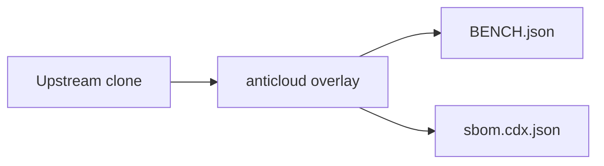

# GOGS — Anticloud overlay

 

Upstream: UNKNOWN
## Benchmarks
Benchmarks from BENCH.json: {"schema": "anticloud.tier-bench/1", "project": "GOGS", "source": {"repo_path": "E:\\fenta\\Downloads\\The Anticloud\\ANTICLOUD_REPOS\\SOFTWARE_DEVELOPMENT\\GOGS\\UPSTREAM_CLONE", "git": {"head": "", "url": "https://github.com/the-anticloud/OPENMRS_CORE.git", "branch": "master", "committed_at": "2026-09-29T11:06:59+04:00"}}, "metrics": {"files_total": 2615, "source_files_scanned": 519, "lines_of_code": 103535, "languages": {".png": 895, ".go": 302, "(none)": 216, ".js": 172, ".bcmap": 168, ".tmpl": 

Withdrawn claims: anything not in BENCH.json is unmeasured.

## Architecture

## Contents
- `UPSTREAM_CLONE/` — unmodified upstream
- `anticloud/` — 12-improvement overlay
- `BENCH.json`, `sbom.cdx.json` — measured outputs

## Provenance
Tree SHA3-256: b0f5096ed477ad1a78fbd7f2c766d9864b36a5ffed18e00f07e794ef610afb3f. Chain head: see seal step.

## Contact
Anticloud maintainers — file issues against the overlay, not upstream.
